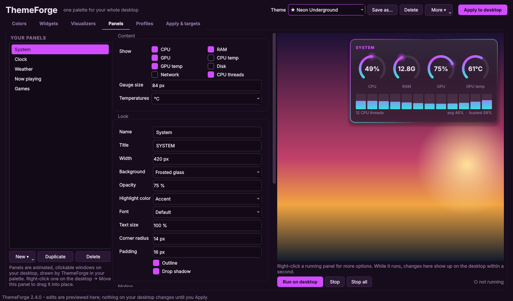
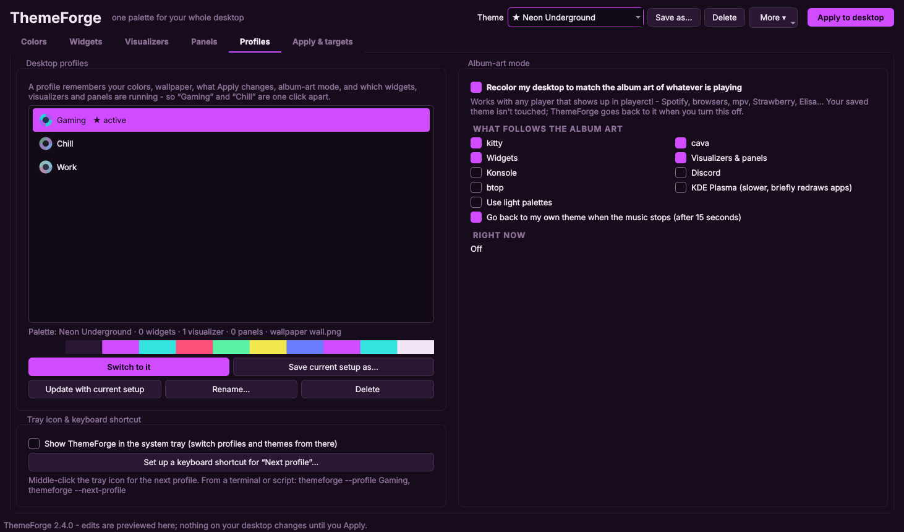

# ThemeForge

**One palette for your whole KDE Plasma desktop.** Pick a theme, pull one from your wallpaper or let it follow the album art of whatever's playing. ThemeForge then recolors your terminal, KDE, your apps and your desktop widgets, panels and music visualizers to match.

Built for **Nobara Linux**, and it works on any Fedora-based KDE Plasma 6 setup.


## Features

### Colors
- 8 built-in themes, plus 8 more community themes you can browse and install from inside the app.
- Generate a dark or light palette from any wallpaper.
- Edit the interface colors, all 16 terminal colors, and a cava gradient of up to 8 stops.
- A live preview shows a KDE window and a terminal running cava.
- Save, import and export your own themes, and share them with everyone through a pull request (see [CONTRIBUTING.md](CONTRIBUTING.md)).

### One click themes all of this

| Target | What happens |
|---|---|
| kitty | Writes `themeforge.conf`, includes it last in `kitty.conf`, and live-reloads open windows. |
| cava | Rewrites only the `[color]` section of its config and live-reloads. |
| KDE Plasma | Applies a color scheme and accent color to apps, panels and title bars. GTK apps using Breeze follow it. |
| Konsole / Yakuake | Sets a color scheme on your default profile. |
| Icons | Switches your icon theme and recolors Papirus folders to match your accent. |
| Discord | Writes a theme for Vencord, Vesktop, Equicord or BetterDiscord. Turn it on once and it updates live. |
| Spotify | Applies a Spicetify color scheme. |
| btop | Writes a btop theme and selects it. |
| Starship | Sets a palette so the named colors in your prompt follow your theme. |
| Vivaldi | Exports a theme for you to import. |
| Widgets, panels & visualizers | Everything ThemeForge draws switches colors instantly. |
| Your own conky configs | Opt-in: swaps `color0–9` / `default_color` for palette colors. |
| Wallpaper | Sets the image the palette came from. |

Every file is backed up before ThemeForge first touches it. **Restore my original files** puts everything back, including your KDE colors, accent and icon theme.

### Desktop widgets (conky)


Build widgets from blocks:
- Clock, date, calendar, headings and text
- CPU, RAM, disk and network, as graphs or bars
- CPU temperature, and GPU usage and temperature (AMD and NVIDIA)
- Top processes and uptime
- Now playing and weather
- Any shell command
- Separators and spacers

While a widget is running, edits show up on it live.

### Panels



Panels are animated, clickable windows on your desktop, drawn by ThemeForge in your palette.

| Panel | What it does |
|---|---|
| Games launcher | Every shortcut in a folder as an icon grid. Icons lift and glow on hover and bounce when clicked. |
| Now playing | Album art (square or a spinning record), scrolling titles, a seekable progress bar and playback buttons that pulse with the bass. |
| Clock | Digital with a sweeping seconds ring, plain digital, or analog. |
| System gauges | Animated arc gauges for CPU, RAM, GPU (NVIDIA or AMD), temperatures and disk, plus per-thread CPU bars and network speed. |
| Weather | Animated icons and a 3-day forecast from wttr.in. |
| Calendar | Month view you can page through. Today glows. |
| Countdown | Days, hours, minutes and seconds to any date, with flip-clock digits. |
| Drives | Free space on every drive, detected automatically. |
| Network graph | Live download and upload, scrolling smoothly. |
| Notes & to-do | Shows a Markdown file. Click checkboxes to tick them off in the file itself. |

Every panel can be customized:
- **Look:** background (solid, gradient, frosted glass, outline), highlight color, font, text size, corner radius, drop shadow.
- **Motion:** entrance (fade, slide, pop), animation speed, breathing glow, animated shimmer outline, glow with the bass, and fade-out while the mouse is over it.

To place a panel, right-click it on the desktop → **Move this panel** and drag it where you want.

### Music visualizers


Run as many as you want at once, each in its own click-through window:
- **10 styles:** bars, mirrored bars, LED blocks, dot columns, wave, mirrored wave, radial ring, a glowing **orb**, a **particle fountain**, and a **frame** that wraps around a panel. A frame around the now playing card turns it into a speaker.
- **Motion:** falling **peak caps**, **spin** for the ring, orb and frame, and **flowing colors** that cycle the gradient.
- **Appearance:** palette gradient or a single color, stereo mode with bass in the middle, rounded bars, bass glow, opacity, smoothing and frame rate.
- **Placement:** any corner or edge, offset in pixels, and choice of monitor.

Audio comes from cava, so anything PipeWire or PulseAudio plays drives them.

### Profiles, album-art mode and the tray icon



- **Profiles** save your whole setup: palette, wallpaper, targets, and which widgets, visualizers and panels are running. Switch between "Gaming" and "Chill" in one click, from the tray icon, a keyboard shortcut or the command line.
- **Album-art mode** recolors your desktop (you pick which parts) to match the cover of the song that's playing. It works with any player playerctl can see: Spotify, browsers, mpv, Strawberry, Elisa and so on. It goes back to your own theme when the music stops.
- **Tray icon** gives quick access to profiles, themes and album-art mode. Middle-click it to switch to the next profile.

### Auto-updates
ThemeForge checks this repo's releases on startup and verifies each download's SHA-256 checksum before replacing anything.

## Install

One-liner (downloads the latest release and verifies its checksum):

```bash
curl -fsSL https://github.com/LibexiL/ThemeForge/releases/latest/download/install.sh | bash
```

Or from a clone:

```bash
git clone https://github.com/LibexiL/ThemeForge.git
cd ThemeForge
bash install.sh
```

The installer pulls in `python3-pyside6 cava conky playerctl curl` with dnf. It then installs ThemeForge to `~/.local/share/themeforge` and adds it to your app menu. You can also launch it by running `themeforge`.

**As a Fedora/Nobara package**, if the COPR repo is published:

```bash
sudo dnf copr enable libexil/themeforge
sudo dnf install themeforge
```

Packaged installs are updated by `dnf` rather than the built-in updater.

## Command line

```
themeforge                     open the app
themeforge --apply             re-apply your saved theme
themeforge --profile Gaming    switch to a profile
themeforge --next-profile      switch to the next profile (bind it to a shortcut)
themeforge --list-profiles
themeforge --update            update to the latest release
themeforge --restore           put back every file ThemeForge changed
themeforge --fix-windows       keep ThemeForge's desktop windows out of the taskbar
themeforge --start-widgets     start everything marked "start at login"
themeforge --version
```

## Uninstall

```bash
bash uninstall.sh            # offers to restore your original configs, keeps saved themes
bash uninstall.sh --purge    # also deletes ~/.config/themeforge
```

## Troubleshooting

- **A widget, panel or visualizer shows up in the taskbar or sits on top of windows.** ThemeForge adds a KWin rule for its windows (titles starting with `themeforge-`) automatically. If they still misbehave, run `themeforge --fix-windows` and restart them, or look for "ThemeForge widgets, panels and visualizers" in System Settings → Window Management → Window Rules.
- **Positioning is ignored.** Keep "Pin to exact position (runs through XWayland)" ticked. Native Wayland doesn't let apps choose where their windows go.
- **Discord doesn't change.** Plain Discord can't load themes. Install [Vencord](https://vencord.dev) or [Vesktop](https://github.com/Vencord/Vesktop), apply once, then turn on "ThemeForge" in Settings → Themes.
- **Spotify doesn't change.** Install [Spicetify](https://spicetify.app) first.
- **The now playing card or album-art mode shows nothing.** Run `playerctl metadata` in a terminal. If that's empty, your player doesn't expose MPRIS (enable it in the player's settings).
- **A visualizer doesn't appear.** Check that `cava` runs on its own, then look at `~/.config/themeforge/visualizers/<id>.log`.

## Contributing and releasing

See [CONTRIBUTING.md](CONTRIBUTING.md) for sharing themes, running the tests, publishing a release and setting up the COPR package.

## License

[MIT](LICENSE)
