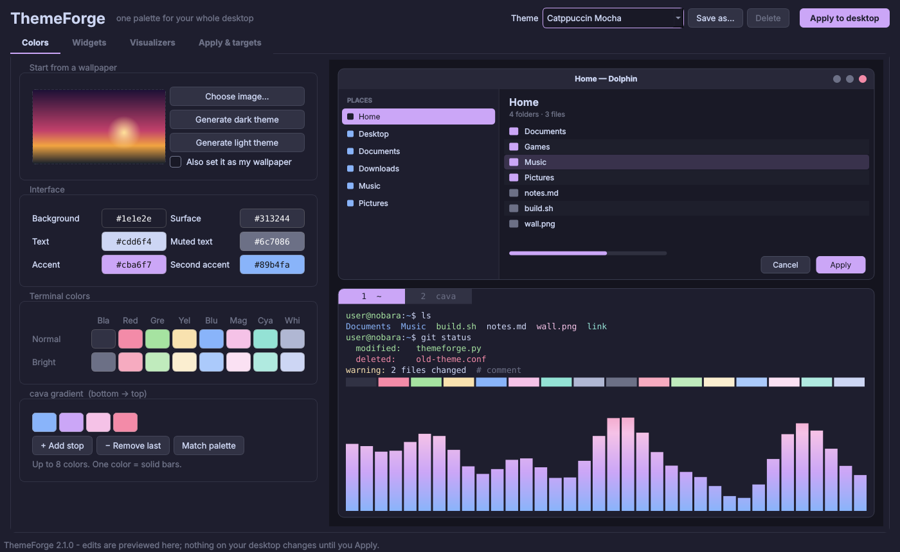
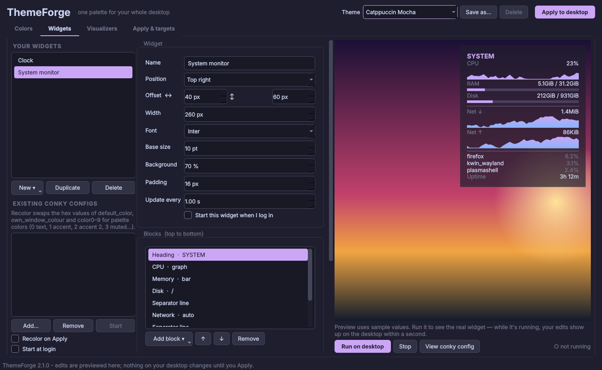
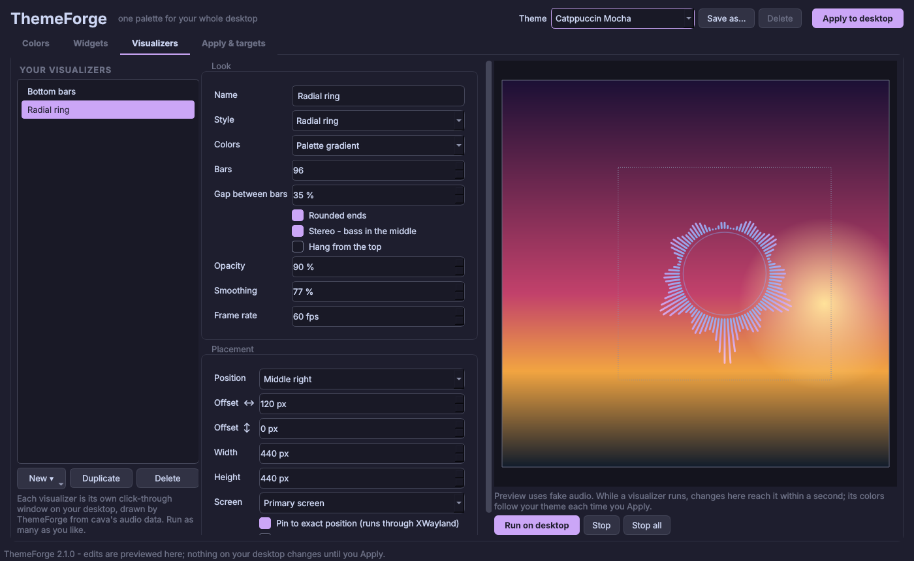

# ThemeForge

**One palette for your whole KDE Plasma desktop.** Pick a theme or pull one from your wallpaper, then theme kitty, cava, KDE Plasma, Konsole and your wallpaper in one click. You can also build your own desktop widgets and music visualizers that follow the same colors.

Built for **Nobara Linux**, and it works on any Fedora-based KDE Plasma 6 setup.



## Features

**Colors**
- 8 built-in themes: Catppuccin Mocha and Latte, Tokyo Night, Nord, Gruvbox Dark, Dracula, Rosé Pine and Everforest.
- Generate a dark or light palette from any wallpaper.
- Edit the interface colors, all 16 terminal colors, and a cava gradient of up to 8 stops.
- A live preview shows a KDE window and a terminal running cava, so you see changes before applying them.
- Save your own themes.

**Apply to desktop**

| Target | What happens |
|---|---|
| kitty | Writes `themeforge.conf` and includes it last in `kitty.conf`. Open windows reload instantly. |
| cava | Rewrites only the `[color]` section of its config and live-reloads. |
| KDE Plasma | Applies a color scheme to apps, panels and title bars. GTK apps using Breeze follow it. |
| Konsole | Sets a color scheme on your default profile. |
| Widgets | Regenerates the widgets you built with the new colors. |
| Visualizers | Running visualizers switch colors instantly. |
| Your conky configs | Opt-in: swaps `color0–9` / `default_color` for palette colors. |
| Wallpaper | Sets the image you generated the palette from. |

Every file is backed up before ThemeForge first touches it. **Restore my original files** puts them all back.

**Desktop widgets** (drawn by conky)



Build widgets from blocks:
- Clock, date, headings and text (conky variables allowed in text)
- CPU, RAM, disk and network, as graphs or bars
- Top processes and uptime
- Now playing (any player that supports playerctl)
- Weather from wttr.in
- Any shell command
- Separators and spacers

While a widget is running, edits show up on it live.

**Music visualizers**



Run as many visualizers as you like at once, each in its own click-through window on your desktop:
- **6 styles:** bars, mirrored bars, LED blocks, wave, mirrored wave, radial ring.
- **Appearance:** palette gradient or a single color, stereo mode with bass in the middle, rounded bars, opacity, smoothing and frame rate.
- **Placement:** any corner or edge, offset in pixels, full screen width, and choice of monitor.
- Audio comes from cava, so anything cava hears (PipeWire, PulseAudio) drives them.

**Auto-updates.** ThemeForge checks this repo's releases on startup. Updates are verified against a published SHA-256 checksum before anything is replaced.

## Install

One-liner (downloads the latest release and verifies its checksum):

```bash
curl -fsSL https://github.com/LibexiL/ThemeForge/releases/latest/download/install.sh | bash
```

Or from a clone:

```bash
git clone https://github.com/LibexiL/ThemeForge.git
cd ThemeForge
bash install.sh
```

The installer pulls in `python3-pyside6 cava conky playerctl curl` with dnf. It then installs ThemeForge to `~/.local/share/themeforge` and adds it to your app menu. You can also launch it by running `themeforge`.

## Command line

```
themeforge                   open the app
themeforge --apply           re-apply your saved theme (handy in scripts)
themeforge --update          update to the latest release
themeforge --restore         put back every file ThemeForge changed
themeforge --start-widgets   start widgets/visualizers marked "start at login"
themeforge --version
```

## Updating

ThemeForge offers new versions with a banner when you open it. You can also update from **Apply & targets → Updates → Check now**, or run `themeforge --update`. If you run ThemeForge from a git clone, it leaves updating to `git pull`.

## Uninstall

```bash
bash uninstall.sh            # offers to restore your original configs, keeps saved themes
bash uninstall.sh --purge    # also deletes ~/.config/themeforge
```

## Troubleshooting

- **KDE accent color doesn't change.** In System Settings → Colors & Themes, set the accent color to "From current color scheme".
- **A widget or visualizer sits on top of windows** (Plasma on Wayland):
  1. Open System Settings → Window Management → Window Rules.
  2. Add a rule for window titles starting with `themeforge-`.
  3. Set "Keep below other windows" to Force.
- **A visualizer doesn't appear.** Check that `cava` runs on its own in a terminal, then look at `~/.config/themeforge/visualizers/<id>.log`.
- **Positioning is ignored.** Keep "Pin to exact position (runs through XWayland)" ticked. Native Wayland doesn't let apps choose where their windows go.

## Releasing (maintainers)

1. Bump `VERSION` in `themeforge.py` and add a section to `CHANGELOG.md`.
2. Commit, then tag and push:
   ```bash
   git tag v2.1.0 && git push origin main v2.1.0
   ```
3. The **Release** workflow then:
   - checks the tag matches `VERSION`
   - runs the tests
   - publishes `themeforge.py`, its `.sha256` and `install.sh` with the changelog as release notes.

   Installed copies pick the release up automatically.

## License

[MIT](LICENSE)
